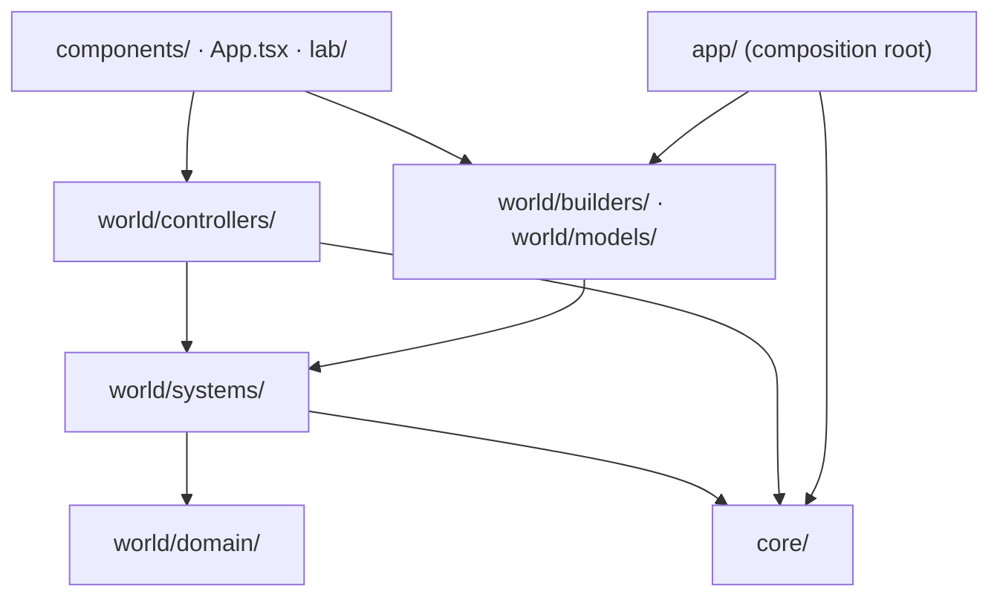
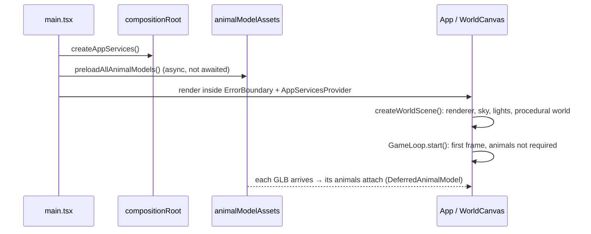

# TheMan — Architecture

How the game is put together: the layers, how one frame flows, and the patterns that keep the
simulation deterministic, testable and fast to start. File paths are relative to the repository
root. The project's coding rules live in `.standards/` (start with `.standards/profile.md`).

## 1. Stack

| Concern | Choice |
|---|---|
| Language | TypeScript (strict) |
| UI shell | React 19 (title screen, HUD, menus, settings, inventory) |
| 3D | three.js 0.186: plain three.js, not React Three Fiber |
| Build | Vite 8 (Rolldown) |
| Tests | `node:test` through `tsx`, no DOM (`npm test`) |
| Styling | Tailwind CSS 4 |

## 2. Source layout and layers

```
src/
  main.tsx               entry: composition root, error boundary, starts model downloads
  App.tsx                game state machine (title / playing / paused), settings, lazy lab
  app/                   composition root + React context for application services
  core/                  framework-free primitives: Result, AppException, ILogger,
                         GameLoop, tick error guard, interpolation, telemetry store
  config/                key bindings, saved settings, validation of persisted data
  locales/               i18n: t(key, params) over the English dictionary (en.ts)
  components/            React UI; WorldCanvas.tsx hosts the 3D world
  world/
    domain/              types and static world data (landmarks, shell contracts)
    systems/             pure simulation: player physics, wildlife AI, combat, weather,
                         camera rig, world clock, weapon feel, terrain queries
    controllers/         adapters between input/browser and systems (frame schedulers,
                         movement intent, HUD telemetry builder, debug bridge)
    builders/            create three.js objects (scene, wildlife layer, player rigs)
    models/              landmark meshes + animal model facades, GLB asset library
  lab/                   Character & Animation Lab (developer tool, lazy-loaded)
  testSupport/           golden-master helper, test-only model preloading
public/models/animals/   animal GLB files (served as static assets)
```

Dependencies point downward only:



- **`world/systems/` is pure.** No DOM, no React, no renderer. Every system is a function over
  plain state, which is why the whole simulation runs in node tests.
- **`core/` has no game knowledge** and imports nothing from `world/` or `components/`.
- **Shared contracts between the 3D world and the React shell** (`GameStateMode`,
  `ITelemetrySnapshot`, `IVirtualMoveState`) live in `world/domain/gameShellTypes.ts`, so no
  layer has to import a React component.

## 3. Startup



## 4. Composition root and services

`src/app/compositionRoot.ts` is the only place that picks concrete infrastructure:

```ts
createAppServices(): IAppServices   // { logger: ILogger, createSoundEngine() }
```

- `main.tsx` calls it once. `AppServicesProvider` puts the services into React context.
- Components read them with `useAppServices()`, which throws `InfrastructureCorruptedException`
  outside the provider.
- Non-React code receives what it needs as parameters. For example, the logger flows
  `createWorldScene → buildRealisticWorld → IWorldModelBuildContext.logger → builders`.
- `ConsoleLogger` is named only in the composition root, so tests pass `NullLogger` or a
  recording fake.

## 5. The game loop

### 5.1 GameLoop (`src/core/gameLoop.ts`)

`GameLoop` owns timing and fault tolerance. What a frame does is decided by its callbacks. All of
its dependencies are injected, which is what makes it unit-testable with a fake scheduler and
clock:

| Option | Production value |
|---|---|
| `scheduler` | `requestAnimationFrame`; on software WebGL (SwiftShader/llvmpipe), GPU-fence pacing (`world/controllers/frameSchedulers.ts`) |
| `now` | `performance.now` |
| `maxFrameSeconds` | 0.25 s |
| `fixedStep` | `{ stepSeconds: 1/60, maxStepsPerFrame: 15, onStep: simulateStep }` |
| `onFrame` | `renderFrame(frameDt, now, alpha)` |
| `maxConsecutiveFailures` | 60 (via `tickErrorGuard`) |
| `onFatalError` | rethrows during React render, so the `ErrorBoundary` shows the recovery screen |

A frame that throws is logged (throttled to one log per 2 s) and the loop keeps going. Sixty
failures in a row halt it.

### 5.2 Fixed timestep with interpolation

This follows Glenn Fiedler's ["Fix Your Timestep"](https://gafferongames.com/post/fix_your_timestep/):

```
accumulator += min(frameTime, 0.25 s)
while accumulator >= 1/60 and steps < 15:
    simulateStep(1/60)          // gameplay state advances in equal steps
    accumulator -= 1/60
if still behind: drop the backlog          // slow device → game slows, never spirals
renderFrame(frameTime, now, alpha = accumulator / (1/60))
```

- **Simulation results do not depend on the frame rate.** The same input gives the same state on
  a 30 Hz laptop and a 144 Hz monitor.
- **Rendering interpolates.** `renderFrame` blends the player pose (position, pitch, and yaw along
  the shorter arc, `core/interpolation.ts`) between the previous and the latest step. The camera
  and the meshes read that blended copy (`renderPlayer`); the simulation never reads it.
- **Render time** is `elapsedTotal − (1 − alpha) · step`. It drives shader time and mesh
  animation, so they stay in sync with the interpolated pose.
- **Trade-off:** input is applied once per step, adding at most one step (~17 ms) of latency.
  Below about 4 FPS, game time runs slower than real time.

### 5.3 What runs where (`components/WorldCanvas.tsx`)

| `simulateStep(dt)` (fixed, 60 Hz) | `renderFrame(frameDt, now, alpha)` (once per frame) |
|---|---|
| world clock and bed fast-forward (`worldClockSystem`) | interpolate the player pose |
| weather and atmosphere (`atmosphereAndWeatherSystem`) | ambient audio |
| movement intent from keys/touch (`movementIntent`) | camera rig: smoothing, 1st/3rd person, bed (`cameraRigSystem`) |
| interactions: loot, beds, doors | underwater fog, FOV easing |
| bow and sword feel (`weaponFeelSystem`) | sun light follows the player |
| sword strike windows, arrows (`combatAndInventorySystem`) | `worldHandles.update`: mesh sync, shader time, landmarks |
| player physics (`playerPhysicsSystem`) | HUD snapshot at most every 100 ms (`hudTelemetryBuilder` → `telemetryStore`) |
| wildlife AI, boids, footprints (`worldHandles.simulateWildlife`) | `renderer.render` |

The wildlife layer is split in the same way. `simulate()` runs the AI and fires sound cues.
`syncMeshes()` copies the state onto meshes and advances the model animators by the frame delta.

### 5.4 React and the frame

React never re-renders per frame. The HUD subscribes to `core/telemetryStore.ts` through
`useSyncExternalStore`, which is fed at most every 100 ms. All per-frame work mutates three.js
objects and plain state objects directly. Hot paths reuse scratch vectors and pose objects
(`createCameraPose`, the movement-axes object) instead of allocating.

## 6. Strategy tables instead of switches

### 6.1 Wildlife species (`world/systems/wildlifeSpeciesProfiles.ts`)

Every per-species number the AI uses lives in one table:

```ts
SPECIES_PROFILES: Readonly<Record<GroundAnimalSpecies, ISpeciesProfile>>
// senses awake/asleep, size rank, predator & pounce flags, melee standoff and reach,
// max HP, wounded alert time, loot, detection ranges, flee/charge/stalk/graze/shelter
// speeds, hop rate, body radii
```

- Getters such as `getAnimalSensoryProfile` or `getAnimalMaxHp` are one-line lookups. The AI step
  reads the table instead of nesting `species === …` ternaries.
- **Adding a species = one entry.** The `Record` type makes the compiler reject a species without
  a profile.
- The remaining `species ===` checks are deliberate. They guard genuinely different behavior
  (bear cave portals, crocodile pack aggro and lunges, rhino charge phases, the dragon boss),
  not tuning numbers.

### 6.2 Other dispatch tables

| Table | File | Replaces |
|---|---|---|
| `EQUIPMENT_STRATEGY_MAP` | `world/systems/combatAndInventorySystem.ts` | a switch over item kinds (bow, sword, arrows…) |
| `EDITOR_LABEL_SETS` | `lab/labCatalog.ts` | a 130-line switch of lab editor labels |
| `PERSISTENCE_ROUTES` | `vite.config.ts` | if-chains in the dev-only save endpoints |

## 7. Animal models: GLB files and async loading

### 7.1 Files (`public/models/animals/*.glb`)

Each of the eight animals (bear, crocodile, jaguar, wolf, rhino, demon dragon, forest dragon,
deer) is a GLB containing:

- the skinned mesh, the skeleton and the embedded JPEG texture
- for the seven clip-driven animals, 13 baked clips (24 keyframes each) as glTF animations
- quantized data (`KHR_mesh_quantization`: int8 normals, uint16 UVs, uint8 weights, int16 clip
  rotations), so the values are exactly those the game was tuned with
- `asset.extras` (`format: "theman-animal-model@1"`): root-motion joint, exact clip durations,
  parent table

The deer's nine animations are procedural IK code, so its GLB has no clips.

### 7.2 Runtime

```mermaid
flowchart LR
  GLB["/models/animals/bear.glb"] -->|fetch| Lib["animalModelAssets<br/>loadAnimalModel()"]
  Lib -->|GLTFLoader + decode| Asset["IAnimalModelAsset<br/>(clip-rig arrays, texture)"]
  Proxy["DeferredAnimalModel<br/>(placed in the world at once)"] -->|awaits| Lib
  Asset -->|createReadyBear()| Model["Bear (rig + animator)"]
  Model -->|attached into| Proxy
```

- **`world/models/animalModelAssets.ts`** is the asset library.
  - One shared promise per model; a failed download can be retried.
  - Decodes the GLB back into the arrays the rigs and animators read.
  - Skin weights are read from the untouched file bytes, because `GLTFLoader` renormalizes them
    in place.
  - `getLoadedAnimalModel(id)` hands models out synchronously once loaded and throws before that.
- **`world/models/deferredAnimalModel.ts`** is a virtual proxy.
  - World code holds one stable object per animal from the first frame.
  - `setState` and `moveSpeed` are remembered and replayed when the model attaches. `update()` is
    a no-op until then.
  - A failed download logs a warning and leaves that animal invisible.
  - The deer adapter (`deerGlbLoader.ts`) behaves the same way. Its `isLoaded()` was already
    guarded by the wildlife code.
- **Playback stays with the existing animator classes** (`*_Complete.ts`), not `AnimationMixer`.
  They add procedural layers on top of the clips (state blending, turn lean, head dips) that the
  mixer would drop.
- **Who loads when:**
  - `main.tsx` starts every download before the world is built.
  - The world never waits for models.
  - The lab (`App.tsx`, `React.lazy`) waits for all of them, because it builds models
    synchronously.

## 8. Persistence and input validation

- **Settings and key bindings** live in `config/savedGameSettings.ts`.
  - Values come from `localStorage` and are merged over code defaults.
  - Everything is validated by `config/persistedSettingsValidation.ts`, which returns a `Result`.
  - Invalid data falls back to the defaults and logs a warning.
- **Dev-only "Save to file" endpoints** (`vite.config.ts`) write settings and lab pose overrides
  back into `src/config/`.
  - Safeguards: same-origin check, JSON-only, 256 KB cap, schema validation, opaque error codes.
  - They are not part of the production build.
- **Key handling** goes through `config/keyBindingMatch.ts`. Bindings are dynamic: either Shift,
  Ctrl or Alt key matches its family. Fixed fallbacks remain on purpose: Esc pauses, arrow keys
  move, F3 shows colliders.

## 9. Errors and logging

| Mechanism | Used for |
|---|---|
| `Result.ok / Result.fail(code)` | expected failures (validation, market transactions) |
| `AppException` subclasses | broken invariants; `InfrastructureCorruptedException` when something that must exist does not |
| `ILogger` (injected) | everything that is logged |
| `GameLoop` + `ErrorBoundary` | a frame loop that keeps failing |

## 10. Build output

- Vite 8 / Rolldown `codeSplitting.groups` (not the deprecated `manualChunks`) produces
  `vendor-three`, `vendor-react` and the app chunk. The lab is a lazy chunk.
- About 1.8 MB of JS+CSS loads before the first frame (~440 KB gzip). The 6.1 MB of model files
  stream in afterwards.

## 11. Testing

`npm test` runs every `*.spec.ts` / `*.test.ts` in node (AAA structure,
`<unit>_When_Should` names).

- **Golden-master (characterization) tests** pin behavior that must not drift during refactors:
  - species rules
  - day/night and per-species wildlife runs
  - player physics, weather, arrows and the sword
  - the camera rig, HUD telemetry and weapon feel
  - every animal model (geometry, skeleton, poses per state)
  - lab labels
- Snapshots live next to the tests in `__golden__/`.
- A missing snapshot fails. `UPDATE_GOLDEN=1 npm test` re-records on purpose, so review the JSON
  diff before committing it.
- `testSupport/animalModelsForTests.ts` loads the real GLB files from disk through the runtime
  decoder (node has no image decoder, so textures stay empty).
- **Before committing:** `npm run lint && npm test && npm run build`.

## 12. Adding things

| To add… | Touch |
|---|---|
| a species | `GroundAnimalSpecies`, one `SPECIES_PROFILES` entry, spawn data, a loot item in `worldTypes` + `en.ts`; behavior only if it is truly new |
| an animal model | export a GLB in the format of §7.1, add its id to `AnimalModelId` / `ANIMAL_MODEL_IDS`, a facade + `createReady…` over `getLoadedAnimalModel`, a golden fingerprint test |
| a per-frame gameplay rule | a pure function in `world/systems/` + tests, called from `simulateStep` |
| something visual per frame | `renderFrame` (read `renderPlayer`, never mutate simulation state there) |
| a key binding | `IGameKeybindings` + defaults, `KEYBINDING_NAMES` in validation, a `KEYBIND_ROWS` entry, `en.ts` label |
| UI text | a key in `src/locales/en.ts`, read with `t()` |
